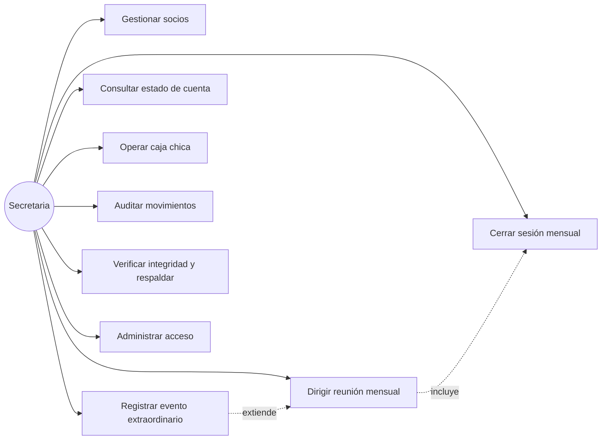
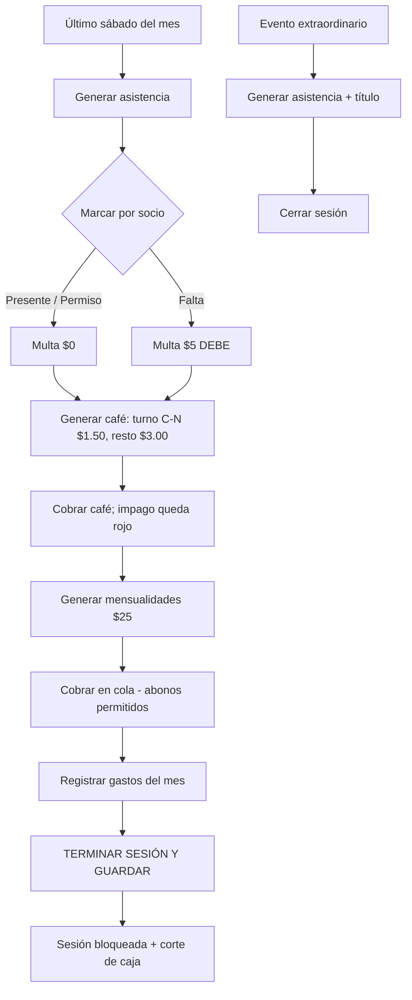

# DOCUMENTO 1 — Especificación de Requerimientos y Procesos del Sistema

**Proyecto:** Módulo Gestión 31 de Enero Narciza de Jesús — **Versión:** 1.2.0
**Fecha:** octubre 2026

---

## 1. Contexto del Sistema

La Asociación 31 de Enero Narciza de Jesús (asociación de vivienda, 69 socios como máximo)
llevaba sus registros en hojas físicas y cuadernos. Cada último sábado del mes la secretaria
toma lista al inicio, sirve el café a mitad de reunión y cobra las mensualidades al final,
anotando todo a mano. Esto generaba deudas poco claras, comprobantes inexistentes y cortes
de caja difíciles de auditar.

El sistema digitaliza ese flujo exacto: CRUD de socios, asistencia con multas, café y rifas
por comisiones, mensualidades de $25 desde octubre 2026, caja chica con corte mensual,
consulta por cédula con comprobante imprimible y auditoría filtrable. Uso local, una sola
usuaria (la secretaria), costo cero en software y hardware.

**Actores:** Secretaria (operadora única y administradora funcional).
**Alcance:** Solo gestión de socios y dinero de la asociación. No incluye contabilidad
externa, nómina ni pagos en línea.

## 2. Historias de Usuario

| ID | Como… | Quiero… | Para… | Criterio de aceptación |
|----|-------|---------|-------|------------------------|
| HU-01 | Secretaria | Registrar/actualizar socios con cédula validada | Tener la nómina oficial de 69 | Cédula 10 dígitos; orden alfabético y N° automáticos |
| HU-02 | Secretaria | Pasar lista al inicio de la reunión | Registrar presente/permiso/falta | Falta genera multa $5 automática |
| HU-03 | Secretaria | Cobrar café por comisión en turno | Que solo el grupo de turno pague $1.50 | Resto paga $3.00; impago queda en rojo DEBE |
| HU-04 | Secretaria | Cobrar mensualidad $25 en la cola final | Cerrar el mes por socio | Acepta abonos parciales; punto o coma decimal |
| HU-05 | Secretaria | Buscar por cédula y ver lo que debe | Mostrar estilo comprobante | Imprimible con logo, firmas y sello |
| HU-06 | Secretaria | Registrar gastos y ver corte mensual | Cuadrar caja chica | Columna comprobante/factura; corte imprimible con logo |
| HU-07 | Secretaria | Terminar la sesión mensual | Congelar lo actuado | Bloquea edición; permite reabrir para corregir |
| HU-08 | Secretaria | Registrar eventos extraordinarios | Pasar lista fuera del sábado | Solo asistencia; sin café ni mensualidad; con título |
| HU-09 | Secretaria | Filtrar auditoría | Rastrear quién hizo qué | Filtros fecha + cédula + tipo |
| HU-10 | Secretaria | Verificar integridad y descargar respaldo | Cuidar los datos | 9 chequeos + descarga .db con fecha |
| HU-11 | Secretaria | Entrar con clave y cerrar el programa | Proteger y apagar seguro | Login + botón ⏻ Cerrar programa |

## 3. Requerimientos Funcionales

| ID | Requerimiento | Regla de negocio |
|----|---------------|------------------|
| RF-01 | CRUD de socios (máx. 69, baja lógica) | Orden alfabético y N° automáticos; comisiones 9×7 + 1×6 por orden de lista |
| RF-02 | Validación de cédula ecuatoriana | 10 dígitos obligatorios; dígito verificador solo advierte |
| RF-03 | Validación de montos | Punto o coma, máx. 2 decimales; rechaza doble punto/letras |
| RF-04 | Reunión ordinaria último sábado del mes | Solo fechas de último sábado seleccionables (lista cerrada) |
| RF-05 | Asistencia | Presente/Permiso = $0; Falta = multa $5 en estado DEBE |
| RF-06 | Café y rifas | Comisión en turno (rota mensual 1→10 desde oct-2026) paga $1.50; resto $3.00; impago en rojo |
| RF-07 | Mensualidades | Cuota $25 desde periodo 2026-10; abonos parciales; deuda inicial independiente por socio |
| RF-08 | Cierre de sesión | Botón Terminar sesión: guarda total, bloquea edición, registra auditoría |
| RF-09 | Evento extraordinario | Cualquier fecha, con título; solo asistencia |
| RF-10 | Consulta por cédula | Ficha con debe por rubro + pagado histórico + N° comprobante; imprimible |
| RF-11 | Caja chica | Ingresos automáticos + gastos manuales con N° comprobante/factura; corte por mes imprimible |
| RF-12 | Auditoría | Filtros fecha + cédula + tipo; registra usuario |
| RF-13 | Integridad y respaldo | 9 chequeos; descarga .db con fecha |
| RF-14 | Autenticación y salida | Login monousuario; botón Cerrar programa apaga todo |

## 4. Requerimientos No Funcionales

| ID | Categoría | Requerimiento |
|----|-----------|---------------|
| RNF-01 | Costo | 100% open-source, licencias $0 (Python, Flask, SQLite, waitress, pywebview, PyInstaller) |
| RNF-02 | Operación | 100% local y offline; sin internet ni servidores externos |
| RNF-03 | Concurrencia | Monousuario; sin requisitos de peticiones simultáneas |
| RNF-04 | Usabilidad | Doble-clic para abrir; splash con logo; ventana pantalla completa sin URLs visibles |
| RNF-05 | Impresión | Comprobante, corte y reportes con logo, firmas y espacio de sello |
| RNF-06 | Mantenibilidad | Respaldo = copiar/descargar 1 archivo `.db`; código en un solo `app.py` comentado |
| RNF-07 | Datos | Capacidad 69 socios; crecimiento esperado solo en montos históricos |
| RNF-08 | Seguridad | Clave de acceso cambiable; baja lógica (no se borra historial) |

## 5. Diagramas de Caso de Uso

Actor único: **Secretaria**. Casos: `Gestionar socios`, `Dirigir reunión mensual`,
`Registrar evento extraordinario`, `Cerrar sesión mensual`, `Consultar estado de cuenta`,
`Operar caja chica`, `Auditar movimientos`, `Verificar integridad y respaldar`,
`Administrar acceso (clave/logo)`, `Cerrar programa`.

## 6. Flujograma del Sistema

