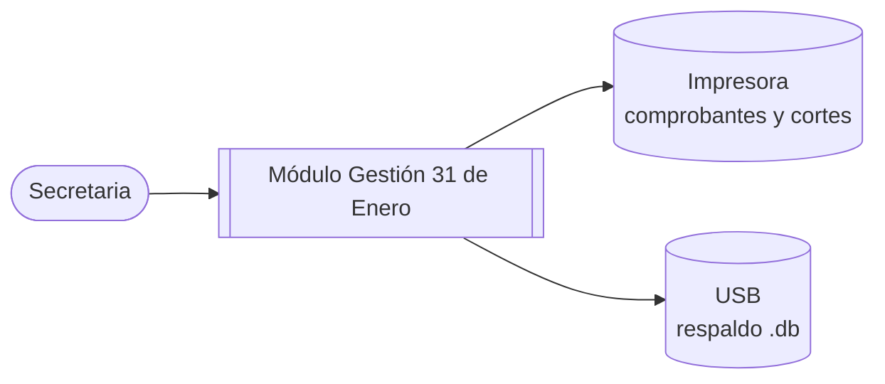
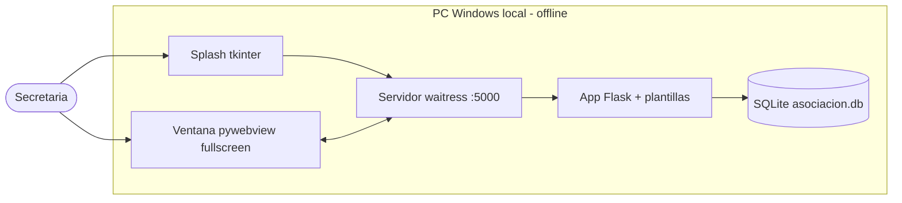
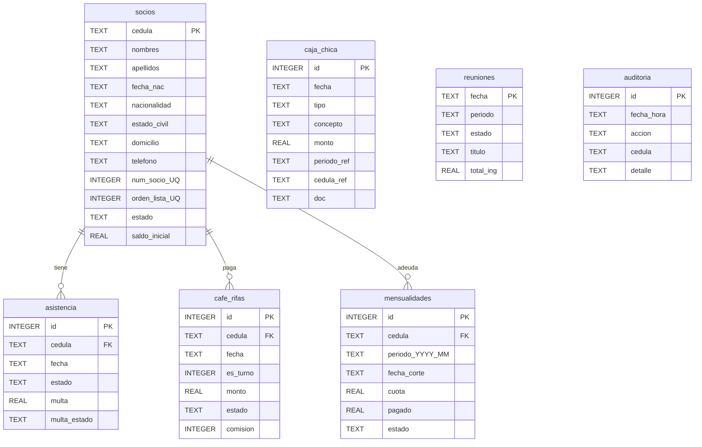

# DOCUMENTO 2 — Arquitectura y Diseño Técnico de Software

**Proyecto:** Módulo Gestión 31 de Enero Narciza de Jesús — **Versión:** 1.2.0

---

## 1. Arquitectura Propuesta y Justificación Técnica

Estilo: **monolito web local monousuario** (sin capas distribuidas: no hay red ni
concurrencia que justifique microservicios).

| Decisión | Opción elegida | Alternativas descartadas | Justificación |
|----------|----------------|--------------------------|---------------|
| Presentación | Web local (HTML/CSS/JS puro) en ventana interna | Tkinter puro, Electron | Impresión de comprobantes perfecta; diseños modernos con CSS; Electron exige Node y pesa +150 MB |
| Ventana interna | pywebview (WebView2/Edge) fullscreen | Mostrar `localhost` en navegador, Eel, CEF | Oculta URLs; WebView2 ya viene en Windows 10/11; plan B automático a Edge modo app |
| Arranque | Splash tkinter fullscreen + waitress en hilo | Consola + Flask dev | tkinter viene con Python ($0); waitress es servidor WSGI serio sin consola |
| Backend | Python + Flask (un `app.py`) | Node/Express, PHP | Sintaxis simple para dar mantenimiento; SQLite incluido en la librería estándar |
| Datos | SQLite, 1 archivo `asociacion.db` | MySQL/Postgres, Excel/CSV | Cero instalación; respaldo = copiar 1 archivo; 69 socios no necesitan servidor |
| Empaque | PyInstaller onedir + icono | Instalador MSI, Docker | Doble-clic sin Python; onedir evita rutas temporales de onefile |
| Gráficos | CSS `conic-gradient` | Chart.js/CDN | Funcionan **offline**; cero dependencias |

## 2. Modelo de Vistas C4

### Nivel 1 — Contexto

### Nivel 2 — Contenedores

### Nivel 3 — Componentes (dentro de la App Flask)

| Componente | Responsabilidad | Rutas |
|------------|-----------------|-------|
| Socios | CRUD + orden alfabético + comisiones | `/socios`, `/socios/eliminar/<ced>` |
| Reunión | Asistencia/café/mensualidad + cierre + extras | `/reunion` |
| Consulta | Deuda por cédula + comprobante | `/consulta` |
| Caja | Ingresos/gastos + corte | `/caja` |
| Auditoría | Bitácora filtrable | `/auditoria` |
| Config | Logo, clave, integridad, respaldo | `/config`, `/integridad`, `/respaldo` |
| Auth | Login, logout, apagado | `/login`, `/logout`, `/salir` |
| Transversales | `cedula_valida`, `parse_monto`, `ultimo_sabado`, `comision_*`, `deuda_socio`, `pie_data` | — |

### Nivel 4 — Código (extracto, solo núcleo crítico)

- `comision_de_orden(o) = (o-1)//7 + 1` → 9 grupos de 7 + grupo 10 de 6.
- `comision_turno_para_fecha(f)` → `((año*12+mes − base Oct-2026) % 10) + 1` (rotación cíclica).
- `ultimo_sabado(año, mes)` → calendario real (ej. oct-2026 = 31).
- `deuda_socio(ced)` → mensualidades pendientes + café DEBE + multas DEBE + inicial vs. pagado histórico.
- `reordenar_alfabetico()` → reasigna `orden_lista = num_socio = 1..N` por apellidos/nombres.
- `parse_monto()` → acepta `25.50`/`25,50`, rechaza `25..50`/letras.

## 3. Diseño de Software

- Patrón: MVC simplificado Flask (rutas = controladores, `sqlite3` directo = modelo,
  Jinja2 = vistas). Sin ORM a propósito: 7 tablas, consultas explícitas y auditables.
- Sesión: cookie firmada (`secret_key`); decorador `login_required` protege todo menos `/login`.
- Cierre de reunión: tabla `reuniones` (`ABIERTA/CERRADA`); cerrada bloquea cargos y pagos.
- Auditoría: cada acción relevante inserta fila con usuario, fecha-hora, tabla y detalle.

## 4. Modelado de Bases de Datos

Restricciones: `UNIQUE(cedula, fecha)` en asistencia/café, `UNIQUE(cedula, periodo)` en
mensualidades, `FOREIGN KEYS` activas, baja de socios lógica (`estado`).

## 5. Maquetación (Wireframes)

- **Login:** tarjeta centrada con logo circular, usuario + clave, botón ancho.
- **Panel:** 5 tarjetas KPI (Socios / Por cobrar / Ingresos / Gastos / Saldo) + 5 pasteles
  espejo + avance de la reunión + top 5 deudores con barras.
- **Socios:** buscador + formulario (cédula con contador, fecha con edad auto, estado civil
  en lista) + tabla con comisión C1–C10.
- **Reunión:** selector de sábados + fecha extra con título; 3 pasos en tarjetas;
  botón verde Terminar sesión; listas con botones Cobrar.
- **Consulta:** encabezado con logo + N° comprobante, tabla debe/pagado, firmas y sello;
  detalle histórico solo en pantalla.
- **Caja/Config/Auditoría:** tablas con encabezado con logo al imprimir; Config con
  integridad (badges OK/REVISAR) y descarga de respaldo.
