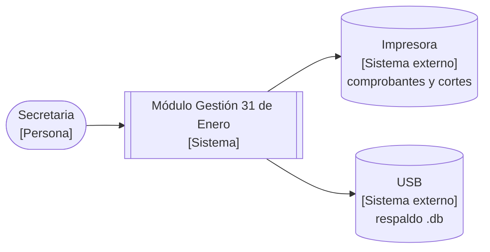

# C4 nivel 1 — Contexto del sistema (evidencia ADR-01)

Sistema: Módulo Gestión 31 de Enero. Sin tecnologías en este nivel.
Nombres consistentes con el ensayo y los ADR.

## Relaciones (verbo + propósito)

- Secretaria → Módulo: dirige reunión mensual, cobra, consulta, audita y respalda.
- Módulo → Impresora: imprime comprobantes CMP-fecha y cortes con logo, firmas y sello.
- Módulo → USB: exporta respaldo `.db` con fecha.

Fuente: `DOCUMENTO2 §2 Nivel 1`.
