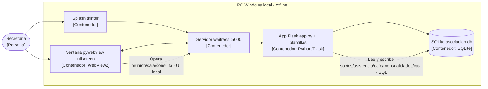

# C4 nivel 2 — Contenedores (evidencia ADR-01 y ADR-02)

Un solo nivel por diagrama. Cada relación lleva verbo y tecnología.
Mismos nombres que el ensayo y los ADR. Renderiza en GitHub.

## Lectura

- ADR-01: `SPL → SRV → APP → DB` y `VENT ↔ SRV` muestran el monolito offline
  (sin contenedores distribuidos: no hay red ni concurrencia que los justifique).
- ADR-02: `APP → DB` concentra las reglas (unicidad, FK, cierre, auditoría);
  el detalle por componente está en el C4 nivel 3 del `DOCUMENTO2 §2`.

Fuente: `DOCUMENTO2 §2 Nivel 2` + `§3` (MVC Flask sin ORM) y `§4` (modelo 7 tablas).
Verificación: abrir este archivo en GitHub o mermaid.live; debe renderizar sin errores.
