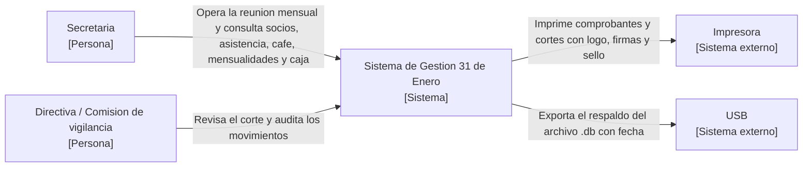
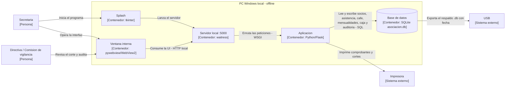

# Dossier de arquitectura — Sistema de Gestión 31 de Enero

**Universidad Politécnica Estatal del Carchi · Posgrado · Maestría en Ingeniería de Software**
**Módulo 8: Automatización de proceso de software — Actividad autónoma Semana 1 (SEM01)**
**Proyecto:** Sistema de Gestión Automatizada y Auditoría para la Asociación “31 de Enero Narciza de Jesús”
**Estudiantes:** Alejandra Valeria Lucero Burbano · José Miguel Guerrero Tapia · Bolívar Alexander Valenzuela Mejía
**Docente:** MSc. José Luis Rodríguez · **Fecha:** 18/10/2026 · **Versión:** v0.1.0 (hito H1)

> Este dossier integra las tres partes del trabajo de la unidad: **levantar** los drivers arquitectónicos (S1), **representar** y documentar la arquitectura (S2) y **decidir** el estilo con una matriz ponderada (S3). Todo el contenido se deriva del caso propio del equipo, según ISO/IEC/IEEE 42010:2022 e ISO/IEC 25010:2023. Los diagramas están en bloques **Mermaid** y se renderizan directamente en GitHub.

## Objetivo

Documentar el contexto del caso, los escenarios de calidad, las vistas C4 y los registros de decisión arquitectónica (ADR), justificando cada decisión con los atributos de calidad del caso y con verificación crítica del uso de inteligencia artificial. El trabajo sigue las tres partes de la unidad: **levantar** los drivers, **representar** la arquitectura con C4 y **decidir** el estilo con una matriz ponderada.

## Convenciones de identificadores

| Prefijo | Significado | Valores en el caso |
|---------|-------------|--------------------|
| S | Stakeholder | S1 a S6 (Paso 1) |
| R | Restricción | R1 a R6 (Paso 2) |
| D | Driver arquitectónico | D1 a D6 (Paso 3) |
| E | Escenario de calidad | E1 a E5 (Paso 4); E6 se incorpora en la Parte III (Paso 10) |
| A | Alternativa de estilo | A1 a A3 (Paso 11) |
| ADR | Registro de decisión arquitectónica | ADR-001 y ADR-002 (Paso 7); ADR-003 (Paso 15) |

## Continuidad entre las tres partes

| Parte | Sesión | Pregunta que responde | Productos | Ubicación en el repositorio |
|-------|--------|-----------------------|-----------|------------------------------|
| I · Levantar | S1 | ¿Qué necesita el sistema y qué condiciona su estructura? | S, R, D y escenarios E1 a E5 | `docs/01-contexto-y-drivers.md` |
| II · Representar | S2 | ¿Cómo se ve la arquitectura y qué se decidió? | C4 niveles 1 y 2, ADR-001 y ADR-002 | `docs/02-vistas-c4/` y `docs/03-adr/` |
| III · Decidir | S3 | ¿Qué estilo sostiene mejor los escenarios? | E6, matriz ponderada, ADR-003 y C4 nivel 2 actualizado | `docs/01`, `docs/02` y `docs/03` |

> **Para opinar en clase.** ¿Qué decisión de este sistema sería más difícil de cambiar una vez construido?

---

# Parte I · Levantar — Práctica 01: Drivers arquitectónicos

## Paso 1 · El caso, stakeholders y concerns

La Asociación “31 de Enero Narciza de Jesús” es una asociación de vivienda con 69 socios como máximo. Cada último sábado del mes la secretaria toma lista, sirve el café a mitad de reunión y cobra las mensualidades al final, anotando todo a mano; esto producía deudas poco claras, comprobantes inexistentes y cortes difíciles de auditar. El sistema digitaliza ese flujo con una sola operadora, **100 % local y offline**, costo cero en software y hardware. Alcance: solo socios y dinero de la asociación (sin contabilidad externa, nómina ni pagos en línea).

Casos de uso: gestionar socios; dirigir la reunión mensual (asistencia con multa, café por comisiones, mensualidades); consultar el estado de cuenta por cédula con comprobante imprimible; operar caja chica con corte; auditar movimientos; verificar integridad y respaldar; cerrar sesión y programa. Sistemas externos: impresora (comprobantes y cortes) y USB (respaldo).

Un *concern* es un interés del stakeholder sobre el sistema, aún no un requisito ni una solución técnica.

| ID | Stakeholder | Rol | Concerns principales | Influencia |
|----|-------------|-----|----------------------|------------|
| S1 | Secretaria | Operadora única y administradora funcional | Cobrar y cerrar sin errores; saldos correctos; operar sin conocimientos técnicos; proteger datos | Alta |
| S2 | Socios / Asamblea (69) | Aportan dinero y reciben servicios | Que su pago quede registrado; comprobante claro; trato justo en café y multas; transparencia | Alta |
| S3 | Directiva | Decide y rinde cuentas | Que la caja cuadre; corte y reportes; cumplir el estatuto; costo mínimo | Media |
| S4 | Comisión de vigilancia | Auditoría interna | Rastrear quién hizo qué; que no se borre el historial | Media |
| S5 | Responsable de protección de datos | Vela por el cumplimiento | Uso lícito de cédulas y datos personales; trazabilidad de accesos | Media |
| S6 | Equipo de desarrollo | Construye y mantiene | Facilidad de cambio; despliegue sencillo; bajo costo; pocas dependencias | Media |

Conflicto de concerns: S1 prioriza rapidez al cobrar; S4/S5 priorizan trazabilidad y control. Se resuelve registrando automáticamente cada acción (auditoría) sin pasos manuales para la secretaria.

## Paso 2 · Restricciones y supuestos

| ID | Tipo | Restricción | Origen | Negociable |
|----|------|-------------|--------|------------|
| R1 | Legal | Datos personales (cédulas, domicilio, teléfono) conforme a la LOPDP (Ecuador) | Normativa (verificar en la fuente oficial) | No |
| R2 | Negocio | Una sola sesión mensual (último sábado); un cobro de café/mensualidad por socio y periodo; rotación de 10 grupos | Estatuto / Asamblea | No |
| R3 | Económica | Presupuesto $0 para software y hardware (solo open-source y equipos existentes) | Directiva | Parcial |
| R4 | Técnica | Una sola PC con Windows, monousuario y sin internet | Infraestructura de la secretaría | Parcial |
| R5 | Organizacional | Equipo pequeño (3–4 personas) y plazo del módulo | Planificación del módulo | No |
| R6 | Negocio | Máximo 69 socios; no se borra historial (baja lógica) | Estatuto / Asamblea | No |

**Supuestos** (a validar si cambia el contexto): la secretaria es la única operadora; no habrá pagos en línea; el respaldo se hace a un USB al cerrar cada reunión; la impresora es la de la oficina.

## Paso 3 · Drivers arquitectónicos

| ID | Driver | Tipo (ISO 25010) | Origen | Importancia | Dificultad |
|----|--------|------------------|--------|-------------|------------|
| D1 | Consistencia financiera: multas, café y mensualidades exactos, con cierre que congela lo actuado | Fiabilidad | S1, S2, R2, R6 | Alta | Alta |
| D2 | Protección de datos personales y trazabilidad de accesos | Seguridad | S5, R1 | Alta | Media |
| D3 | Facilidad de cambio (tarifas y reglas en un único punto) y mantenibilidad | Mantenibilidad / Flexibilidad | S6, R3 | Media | Media |
| D4 | Operación local offline, de un solo usuario y sin instalar dependencias | Usabilidad / Portabilidad | S1, R4 | Alta | Media |
| D5 | Desempeño y disponibilidad durante la reunión | Eficiencia de desempeño / Disponibilidad | S1, S3 | Media | Baja |
| D6 | Corte de caja y comprobante imprimible con logo, firmas y sello | Adecuación funcional | S2, S3, R2 | Alta | Media |

Priorización (importancia × dificultad): D1 (Alta/Alta) → D2, D4, D6 (Alta/Media) → D3 (Media/Media) → D5 (Media/Baja).

## Paso 4 · Escenarios de calidad (E1 a E5)

Cada escenario tiene seis partes y una sola medida numérica comprobable. E6 se incorpora en la Parte III (Paso 10).

### E1 — Consistencia financiera · driver D1

| Parte | Contenido |
|-------|-----------|
| Fuente | Secretaria |
| Estímulo | Cierra la sesión del último sábado del mes |
| Entorno | Reunión mensual normal, 69 socios, sin internet |
| Artefacto | Módulo Reunión (cálculo de multas/café/mensualidades) y cierre de sesión |
| Respuesta | Calcula los totales, aplica las reglas ($5,00 falta; café $1,50 turno y $3,00 resto; cuota $25,00), guarda y bloquea la edición |
| Medida | **0 inconsistencias** en el corte y **100 %** de saldos exactos; cierre en **≤ 2 s** |

### E2 — Seguridad · driver D2

| Parte | Contenido |
|-------|-----------|
| Fuente | Usuario no autenticado |
| Estímulo | Abre el programa o solicita una ruta protegida |
| Entorno | Operación normal |
| Artefacto | Capa de autenticación (login + `login_required`) |
| Respuesta | Deniega el acceso, redirige a `/login` y registra el intento en auditoría |
| Medida | **100 %** de accesos no autenticados denegados y registrados en **≤ 1 s** |

### E3 — Facilidad de cambio · driver D3

| Parte | Contenido |
|-------|-----------|
| Fuente | Directiva |
| Estímulo | Pide cambiar la cuota mensual o el monto del café |
| Entorno | Desarrollo |
| Artefacto | Capa de reglas financieras centralizada |
| Respuesta | El cambio se hace en un único punto sin tocar otras reglas ni pantallas |
| Medida | **≤ 1 día-persona** y **0 cambios** en los módulos de asistencia, consulta y caja |

### E4 — Usabilidad / operabilidad offline · driver D4

| Parte | Contenido |
|-------|-----------|
| Fuente | Secretaria |
| Estímulo | Abre el sistema en una PC nueva sin internet |
| Entorno | Sin conexión, PC con Windows |
| Artefacto | Ejecutable + splash + ventana interna (pywebview) |
| Respuesta | Abre en ventana propia, permite iniciar sesión y operar |
| Medida | Arranque **≤ 6 s**; `/login` responde **200** sin internet; **0** pasos de instalación de dependencias |

### E5 — Desempeño · driver D5

| Parte | Contenido |
|-------|-----------|
| Fuente | Secretaria |
| Estímulo | Consulta por cédula en la cola final (hasta 69 consultas seguidas) |
| Entorno | Reunión, cola final |
| Artefacto | Módulo Consulta |
| Respuesta | Muestra la ficha con lo que debe y lo pagado, más el comprobante |
| Medida | **95 %** de las consultas respondidas en **≤ 1 s** con 69 socios |

## Paso 9 · Contraste con IA (Parte I)

Herramienta: **Claude (Anthropic)** (versión web, octubre de 2026). Se le entregó la descripción del caso sin datos personales ni credenciales y con el rol de revisor crítico: señalar concerns ambiguos, drivers no cubiertos por ISO/IEC 25010:2023 y escenarios sin medida verificable.

| Qué se pidió | Qué respondió la IA | Aceptado | Modificado / rechazado | Cómo se verificó |
|--------------|---------------------|----------|------------------------|------------------|
| Revisar stakeholders, restricciones, drivers y escenarios | Sugirió añadir un concern de “rendimiento perceptible” y separar la disponibilidad del desempeño | Se añadió D5 con desempeño/disponibilidad | Se rechazó “rendimiento perceptible” por no ser medible | Contraste con el caso y las medidas de E1–E5 |

---

# Parte II · Representar — Práctica 02: Documentación de arquitectura (C4 y ADR)

## Paso 5 · C4 nivel 1 — Contexto

Representa el sistema como una **sola caja**, con las personas y los sistemas externos que interactúan con él. **No se muestran tecnologías** (los contenedores viven en el nivel 2).

| Elemento | Tipo | Responsabilidad |
|----------|------|-----------------|
| Secretaria (S1) | Persona | Opera la reunión: socios, asistencia, café, mensualidades, caja, consulta y cierre |
| Directiva / Comisión de vigilancia (S3, S4) | Persona | Recibe el corte y los reportes; audita los movimientos |
| Sistema de Gestión 31 de Enero | Sistema | Digitaliza la operación mensual y audita el dinero de la asociación |
| Impresora | Sistema externo | Imprime comprobantes y cortes con logo, firmas y sello |
| USB | Sistema externo | Recibe el respaldo del archivo de datos |

*Figura 1. C4 nivel 1: contexto del Sistema de Gestión 31 de Enero (`docs/02-vistas-c4/c4-nivel1-contexto.md`).*

## Paso 6 · C4 nivel 2 — Contenedores

Abre la caja del sistema para mostrar las aplicaciones y el almacén de datos con su **tecnología**, y las relaciones **etiquetadas**. Refleja la decisión de estilo del ADR-003 (Paso 15).

| Contenedor | Tecnología | Responsabilidad | Atiende (driver · escenario) |
|------------|------------|-----------------|------------------------------|
| Splash | tkinter fullscreen | Muestra el logo al arrancar y lanza el servidor | D4 · E4 |
| Servidor local | waitress (:5000) | Sirve la aplicación en la PC, sin consola ni internet | D4 · E4 |
| Aplicación | Python + Flask (`app.py` + Jinja2) | Reglas: socios, reunión, café, mensualidades, caja, auditoría, integridad, login | D1, D2, D3, D6 · E1–E6 |
| Base de datos | SQLite (`asociacion.db`, 1 archivo) | Persistencia con `UNIQUE` y claves foráneas | D1, D2 · E1, E2, E6 |
| Ventana interna | pywebview (WebView2/Edge) | Muestra la interfaz sin exponer URLs | D4 · E4 |

*Figura 2. C4 nivel 2: contenedores (`docs/02-vistas-c4/c4-nivel2-contenedores.md`). En el repositorio el diagrama usa orientación horizontal (`flowchart LR`).*

## Paso 7 · ADR-001 y ADR-002

| Campo | ADR-001 |
|-------|---------|
| Título | Persistencia en un único archivo SQLite local |
| Estado | Aceptada |
| Contexto | Sistema monousuario y 100 % offline (R4), presupuesto $0 (R3) y 69 socios (R6); requiere saldos exactos (E1, D1), trazabilidad (E2, D2) y respaldo simple (E6) |
| Decisión | Usar SQLite con un único archivo `asociacion.db`, sin ORM (`sqlite3` directo), con `UNIQUE(cedula, fecha)` y `UNIQUE(cedula, periodo)`, claves foráneas activas y baja lógica (`estado`) |
| Alternativas descartadas | MySQL/PostgreSQL local (exige servidor, contradice R3/R4); Excel/CSV (sin transacciones ni unicidad, riesgo de duplicados en E1) |
| Consecuencias a favor | Cero instalación; respaldo = copiar un archivo (E6); transacciones y `UNIQUE` garantizan E1 sin coordinar componentes; cero licencias |
| Consecuencias en contra | Acoplamiento al motor SQLite y límite de escritura concurrente (irrelevante en monousuario); migración costosa si pasara a multiusuario o red |
| Vínculo | Drivers D1, D2; escenarios E1, E2, E6; restricciones R3, R4, R6; C4 nivel 2: Aplicación → Base de datos y Base de datos → USB |

| Campo | ADR-002 |
|-------|---------|
| Título | Reglas financieras centralizadas, cierre bloqueante y auditoría |
| Estado | Aceptada |
| Contexto | Reglas determinantes y auditables: multa $5,00; café $1,50 en turno (rotación de 10 grupos) y $3,00 al resto; cuota $25,00 desde 2026-10 con abonos; cierre que congela (E1, E5, D1/D6); la comisión de vigilancia exige rastrear acciones (E2, D2) |
| Decisión | Centralizar las reglas en una capa de servicio única; tabla `reuniones` ABIERTA/CERRADA que al cerrar bloquea cargos y pagos (reapertura solo para corregir); auditoría filtrable por fecha + cédula + tipo; baja lógica y 9 chequeos de integridad |
| Alternativas descartadas | Lógica dispersa en plantillas (inconsistencias); borrado físico (rompe historial); edición libre tras el cierre (invalida cortes y auditoría) |
| Consecuencias a favor | Saldos deterministas (E1); 0 comprobantes contradictorios; 100 % de acciones `CERRAR`/`PAGO` trazables (E2); errores detectables (huérfanos, sobrepagos) |
| Consecuencias en contra | Cambiar una tarifa exige migración controlada; centralizar obliga a disciplina de único punto de cambio |
| Vínculo | Drivers D1, D2, D6; escenarios E1, E2, E5; restricciones R1, R2, R6; C4 nivel 2: Aplicación → Base de datos |

## Paso 8 · Trazabilidad driver → vista → ADR y revisión cruzada

| Driver · escenario | Vista C4 que lo atiende | ADR |
|--------------------|-------------------------|-----|
| D1 · E1 | Nivel 2: Aplicación → Base de datos | ADR-001, ADR-002, ADR-003 |
| D2 · E2 | Nivel 1: Directiva/Comisión; Nivel 2: Aplicación (login + auditoría) | ADR-002 |
| D4 · E4 | Nivel 2: Splash → Servidor → Ventana | ADR-003 |
| D5 · E5 | Nivel 2: Aplicación → Impresora | ADR-002 |

Revisión cruzada (intercambio entre equipos). Hallazgos y correcciones aplicadas:

| N.º | Hallazgo | Criterio | Decisión | Corrección |
|-----|----------|----------|----------|------------|
| 1 | Relación Ventana ↔ Servidor sin protocolo | Relaciones etiquetadas | Modificar | Se agregó “Consume la UI - HTTP local” |
| 2 | La base de datos aparecía en el nivel 1 | Niveles separados | Modificar | La base de datos se movió al nivel 2 |
| 3 | Se usaban “App” y “Aplicación” | Nombres consistentes | Modificar | Se unificó a “Aplicación” |
| 4 | Faltaba el actor que audita (S3/S4) | Cobertura de stakeholders | Aceptar | Se agregó Directiva/Comisión de vigilancia |
| 5 | Tras el borrador IA, una flecha Aplicación → Base de datos no tenía etiqueta | Relaciones etiquetadas | Modificar | Se agregó “Lee y escribe … - SQL” |

Se rechazó la sugerencia de representar a los **69 socios como actores individuales**: no interactúan directamente con el sistema y su concern se canaliza por la secretaria y el corte impreso.

---

# Parte III · Decidir — Práctica 03: Comparación y selección de arquitectura

## Paso 10 · Escenario nuevo (E6)

Al comparar estilos aparece el riesgo de perder datos en un equipo local sin red; se registra como E6.

### E6 — Disponibilidad / tolerancia a fallos · drivers D1, D5

| Parte | Contenido |
|-------|-----------|
| Fuente | Fallo de energía o de disco |
| Estímulo | Corte durante la reunión o archivo de datos dañado |
| Entorno | Operación normal, sin internet |
| Artefacto | Persistencia SQLite + respaldo + verificación de integridad |
| Respuesta | No se pierden datos; al reabrir se detectan anomalías; el respaldo es restaurable |
| Medida | **0 registros perdidos** tras el reinicio; **9 de 9** chequeos de integridad; respaldo descargado en **≤ 5 s** |

## Paso 11 · Priorización de escenarios y alternativas

| Escenario | Driver | Impacto en el negocio | Costo de cambiarlo después | Prioridad |
|-----------|--------|-----------------------|----------------------------|-----------|
| E1 Consistencia financiera | D1 | Alto: un saldo mal calculado rompe la confianza y el corte | Alto: atraviesa datos, reglas y comprobantes | 1 |
| E2 Seguridad y datos personales | D2 | Alto: cédulas y datos personales; riesgo legal (LOPDP) | Alto: afecta todos los puntos de entrada | 2 |
| E4 Operabilidad offline | D4 | Alto: si no abre sin internet, no hay reunión | Medio: depende del empaquetado y la ventana | 3 |
| E6 Tolerancia a fallos y respaldo | D1, D5 | Alto: perder la caja del mes es inaceptable | Medio: depende de dónde y cómo se persista | 4 |
| E3 Facilidad de cambio | D3 | Medio: cambian tarifas de vez en cuando | Bajo: se puede preparar después | 5 |
| E5 Desempeño de consulta | D5 | Medio: molesta en la cola, pero no bloquea | Bajo: se corrige con índices | 6 |

| ID | Alternativa | Descripción | Costo operativo |
|----|-------------|-------------|-----------------|
| A1 | Monolito web local monousuario | Una sola aplicación (Flask) con una sola base de datos (SQLite) y ventana interna (pywebview); 100 % offline, empaquetada como ejecutable | Bajo: un despliegue y un proceso; $0 licencias |
| A2 | Cliente-servidor con base de datos en red | Cliente de escritorio/navegador que llama a un servidor con MySQL/PostgreSQL en la red de la asociación | Medio: requiere un servidor de base de datos y red |
| A3 | Microservicios en la nube | Servicios pequeños independientes, cada uno con su base de datos, desplegados en internet | Alto: varios despliegues, red entre servicios e internet |

## Paso 12 · Criterios y pesos

| N.º | Criterio | Origen | Peso | Cómo se evalúa |
|-----|----------|--------|------|----------------|
| 1 | Consistencia financiera | E1 · D1 | 25 % | Garantizar 0 inconsistencias en el corte con poca complejidad |
| 2 | Seguridad y datos personales | E2 · D2 · R1 | 15 % | Puntos de control de acceso, auditoría y superficie expuesta |
| 3 | Operabilidad offline en PC única | E4 · D4 · R4 | 20 % | Funcionar sin internet ni instalar dependencias |
| 4 | Tolerancia a fallos y respaldo | E6 · D1/D5 | 15 % | Aislamiento del fallo y facilidad de respaldo/restauración |
| 5 | Facilidad de cambio | E3 · D3 | 10 % | Cambios para modificar una tarifa o una regla |
| 6 | Desempeño y costo operativo | E5 · D5 · R3/R5 | 15 % | Latencia en la consulta y carga de operación para un equipo pequeño |
| | **Total** | | **100 %** | |

## Paso 13 · Matriz ponderada

| Criterio | Peso | A1 | A2 | A3 |
|----------|------|----|----|----|
| 1. Consistencia financiera (E1) | 25 % | 5 | 4 | 2 |
| 2. Seguridad y datos personales (E2) | 15 % | 4 | 5 | 3 |
| 3. Operabilidad offline en PC única (E4) | 20 % | 5 | 1 | 1 |
| 4. Tolerancia a fallos y respaldo (E6) | 15 % | 4 | 3 | 4 |
| 5. Facilidad de cambio (E3) | 10 % | 4 | 3 | 5 |
| 6. Desempeño y costo operativo (E5) | 15 % | 5 | 2 | 1 |
| **Total ponderado (de 5)** | **100 %** | **4,60** | **3,00** | **2,40** |

Justificación observable de cada calificación:

- **Consistencia (E1):** A1 (5) una transacción local en SQLite aplica `UNIQUE` y calcula saldos sin coordinar componentes; A2 (4) la base central permite transacción pero exige operar el servidor; A3 (2) exige coordinar servicios (transacción distribuida/saga).
- **Seguridad (E2):** A1 (4) un solo punto de login y auditoría, superficie pequeña; A2 (5) control central de acceso; A3 (3) más servicios expuestos y credenciales.
- **Offline (E4):** A1 (5) abre y opera sin internet; A2 (1) depende de la red y del servidor; A3 (1) depende de internet.
- **Fallos y respaldo (E6):** A1 (4) respaldo = copiar 1 archivo; A2 (3) respaldo central pero un fallo detiene la operación; A3 (4) aísla fallos, pero el respaldo se reparte entre varias bases.
- **Facilidad de cambio (E3):** A1 (4) reglas en un único `app.py`; A2 (3) redespliegue del servidor; A3 (5) servicio independiente por dominio.
- **Desempeño y costo (E5):** A1 (5) consulta local indexada y $0; A2 (2) requiere servidor y su administración; A3 (1) varios servicios y habilidades que exceden al equipo.

### Rúbrica de calificación (1 a 5)

Los valores 2 y 4 se usan cuando la alternativa queda entre dos descripciones. En el criterio 6, un **5** significa el **menor costo y la menor carga**.

| Criterio | 5 (mejor) | 3 (intermedio) | 1 (peor) |
|----------|-----------|----------------|----------|
| 1. Consistencia (E1) | Una transacción local garantiza 0 inconsistencias sin coordinar componentes | Requiere coordinar componentes (sagas/compensaciones) | No se puede garantizar la medida |
| 2. Seguridad (E2) | Un solo punto de control y auditoría; poca superficie | Control en varios puntos; auditoría a consolidar | Control disperso, sin registro central |
| 3. Offline (E4) | Abre y opera sin internet, sin instalar dependencias | Requiere red local o algún componente externo | No funciona sin internet/servidor |
| 4. Fallos y respaldo (E6) | Respaldo de 1 artefacto y fallo aislado | Respaldo posible pero con componente extra que operar | El fallo detiene la operación o se pierden datos |
| 5. Facilidad de cambio (E3) | Cambio en un componente que se despliega solo | Cambio acotado, con redespliegue completo | Cambio disperso |
| 6. Desempeño y costo (E5) | Consulta local ágil; lo opera una persona con $0 | Un componente adicional operable | Varios servicios y habilidades que exceden al equipo |

## Paso 14 · Trade-offs y análisis de sensibilidad (ATAM simplificado)

| Riesgo de la alternativa ganadora (A1) | Escenario | Mitigación |
|----------------------------------------|-----------|------------|
| Pérdida de datos si falla el disco local | E6 | Respaldo `.db` al USB al cerrar + verificación de integridad (9 chequeos) |
| Un saldo mal cargado contamina el historial | E1 | Cierre bloqueante con reapertura controlada + auditoría |
| Crecimiento a multiusuario o multi-oficina | E4 | Se revisa la decisión si cambia el contexto (ver sensibilidad) |

| Alternativa | Pesos base (offline 20 %, cambio 10 %) | Pesos alternos (offline 5 %, cambio 25 %) |
|-------------|----------------------------------------|-------------------------------------------|
| A1 Monolito local | **4,60** | **4,45** |
| A2 Cliente-servidor en red | 3,00 | 3,30 |
| A3 Microservicios en la nube | 2,40 | 3,00 |

**Lectura:** con los pesos base gana A1 (4,60) por amplio margen. Si la asociación adoptara internet y varios dispositivos (bajando el peso de “offline” y subiendo el de “facilidad de cambio”), A1 sigue ganando (4,45), pero la ventaja se reduce de 1,60 a 1,15 puntos sobre A2. **Punto de sensibilidad:** la decisión depende de que la operación siga siendo local y monousuario.

**Trade-off explícito:** A1 sacrifica escalabilidad y cambio por dominio (que ofrecería A3) y la centralización del acceso en red (que ofrecería A2) a cambio de consistencia, operación offline y costo/operación mínimos, lo correcto para 69 socios con una sola operadora y presupuesto $0 (R3, R4, R5).

## Paso 15 · ADR-003 y C4 nivel 2 actualizado

| Campo | ADR-003 |
|-------|---------|
| Título | Estilo — monolito web local monousuario de código abierto |
| Estado | Aceptada |
| Contexto | La asociación requiere 0 inconsistencias (E1, D1), protección de datos y trazabilidad (E2, D2), operación offline en una sola PC (E4, D4) y respaldo recuperable (E6), con un equipo de 3–4 personas (R5) y presupuesto $0 (R3). La matriz favorece A1 (4,60) sobre A2 (3,00) y A3 (2,40) |
| Decisión | Adoptar un monolito web local de código abierto: Python + Flask en un único `app.py` (MVC simplificado, sin ORM); waitress en hilo; pywebview fullscreen; splash tkinter; SQLite en un archivo `asociacion.db`; PyInstaller onedir; gráficos con CSS `conic-gradient` (offline) |
| Alternativas descartadas | A2 cliente-servidor en red (contradice R3/R4; 3,00); A3 microservicios en la nube (costo y consistencia distribuida desproporcionados; 2,40) |
| Consecuencias a favor | Protege E1 con una transacción local; E4 con operación 100 % offline; E6 con respaldo de un solo archivo; costo $0. Un solo despliegue que opera una sola persona |
| Consecuencias en contra | Menor escalabilidad y sin despliegue independiente por dominio; acoplamiento de persistencia, lógica e interfaz en un ejecutable; si pasara a multiusuario/multi-oficina habría que redefinir límites y despliegue (punto de sensibilidad) |
| Vínculo | Drivers D1, D3, D4, D6; escenarios E1, E3, E4, E6; restricciones R3, R4, R5; matriz ponderada; C4 nivel 2 (que se mantiene vigente tras la decisión) |

> La vista C4 nivel 2 del **Paso 6** es el estado **posterior** a esta decisión (un proceso Flask + un archivo SQLite; sin broker ni servicios separados) y se mantiene vigente.

## Paso 16 · Contraste con IA (abogado del diablo)

Herramienta: **Claude (Anthropic)** (versión web, octubre de 2026). Se le pidió actuar como abogado del diablo de la decisión (sin proponer una arquitectura nueva) y devolver objeciones con el escenario afectado y la evidencia que cambiaría la decisión.

| Objeción de la IA | Evidencia (escenario y medida) | Decisión | Verificación |
|-------------------|-------------------------------|----------|--------------|
| El equipo local puede perder datos y la caja del mes | E6: 0 registros perdidos; respaldo en ≤ 5 s | Aceptar: registrar como consecuencia en contra + respaldo `.db` | Prueba de respaldo/restauración y 9 chequeos de integridad |
| El criterio “costo” favorece al monolito | E5 · R3/R5: consulta local y $0 | Modificar: subir el peso de “offline” y correr sensibilidad | Recálculo de la matriz con pesos alternos |
| Adoptar microservicios por modernidad | E1: 0 inconsistencias en el corte | Rechazar: contradice R3/R4/R5 y ninguna medida lo respalda | Contraste con la matriz y los escenarios |

---

# Cierre y entregables

## Trazabilidad final (escenario → driver → ADR → vista C4)

| Escenario | Driver | ADR que lo respalda | Vista C4 |
|-----------|--------|---------------------|----------|
| E1 Consistencia financiera | D1 | ADR-001, ADR-002, ADR-003 | Nivel 2: Aplicación → Base de datos |
| E2 Seguridad y datos | D2 | ADR-002 | Nivel 1: Directiva/Comisión; Nivel 2: Aplicación (login y auditoría) |
| E3 Facilidad de cambio | D3 | ADR-002, ADR-003 | Nivel 2: Aplicación |
| E4 Operabilidad offline | D4 | ADR-003 | Nivel 2: Splash → Servidor → Ventana |
| E5 Desempeño de consulta | D5 (y D6) | ADR-002 | Nivel 2: Aplicación → Impresora |
| E6 Tolerancia a fallos y respaldo | D1, D5 | ADR-001, ADR-003 | Nivel 2: Base de datos → USB |

El driver **D6** (corte y comprobante imprimible) se verifica a través de E1 y E5 y queda respaldado por el ADR-002.

## Conclusiones

- La decisión más difícil de cambiar es el **estilo monolítico local con persistencia en SQLite** (ADR-001 y ADR-003), porque atraviesa datos, reglas y empaquetado; por eso se documentó con alternativas, consecuencias y puntos de sensibilidad.
- La **matriz ponderada** favorece al monolito web local (A1, **4,60**) frente al cliente-servidor en red (A2, 3,00) y a los microservicios en la nube (A3, 2,40), y el resultado se mantiene aun moviendo los pesos más discutibles (**4,45**).
- El principal **riesgo aceptado** es la pérdida de datos por fallo del equipo local (E6), mitigado con el respaldo del archivo `.db` a USB y nueve chequeos de integridad.
- La decisión debe **revisarse** si la asociación pasa a operar con varios usuarios, varios dispositivos o internet, ya que ese supuesto sostiene la ventaja de A1.

## Entregables en el repositorio

El dossier integra contexto, escenarios, vistas C4, ADR y matriz de decisión en el repositorio, con historial de commits y etiqueta del hito **v0.1.0**.

- `docs/01-contexto-y-drivers.md` — contexto, stakeholders, restricciones, drivers y escenarios E1–E6.
- `docs/02-vistas-c4/` — C4 niveles 1 y 2 como código, revisión cruzada.
- `docs/03-adr/` — ADR-001, ADR-002, ADR-003 y matriz de decisión.
- `docs/04-registro-ia.md` — registro del uso de IA.

Repositorio: https://github.com/bolimirme16/modulo-gestion-31-de-enero

## Registro de uso de inteligencia artificial

Se usaron dos herramientas con roles distintos y complementarios: **Google Gemini** para generar el borrador del código Mermaid de los diagramas C4 y **Claude (Anthropic)** para la revisión crítica del borrador. No se ingresaron datos personales, credenciales ni información confidencial; el análisis, los pesos, las calificaciones y la decisión son de autoría del equipo.

### Tabla IA-1 · Google Gemini — generación de los diagramas C4 (Mermaid)

| Campo | Descripción del estudiante |
|-------|----------------------------|
| **Tarea realizada** | Generar el borrador del código Mermaid de los diagramas C4: nivel 1 (contexto, Paso 5) y nivel 2 (contenedores, Paso 6). |
| **Prompt utilizado (texto exacto)** | “Actúa como asistente de documentación de arquitectura. Con esta descripción del sistema (secretaria única; monolito Flask + SQLite + pywebview + waitress + PyInstaller; 100 % offline; impresora y USB), genera un borrador de diagrama C4 nivel 1 y nivel 2 como código Mermaid (flowchart LR). Usa solo los elementos de la descripción, no agregues contenedores ni tecnologías, no mezcles niveles, y da a cada relación un verbo y, en el nivel 2, la tecnología.” |
| **Output recibido (resumen)** | Dos bloques `flowchart LR`: contexto (personas y sistemas externos) y contenedores (splash, servidor, aplicación, base de datos, ventana) con relaciones etiquetadas. |
| **Correcciones realizadas** | Se agregaron etiquetas de tecnología (HTTP local, WSGI, SQL); se renombró “App” → “Aplicación”; la base de datos se movió del nivel 1 al nivel 2; se agregó el actor “Directiva / Comisión de vigilancia”; se añadió la etiqueta “Lee y escribe … - SQL”. |
| **Valoración personal** | Útil como borrador de la sintaxis Mermaid; exigió revisión manual y de render; no se aceptó ningún elemento sin contrastarlo con el repositorio. |

### Tabla IA-2 · Claude (Anthropic) — revisión crítica del borrador

| Campo | Descripción del estudiante |
|-------|----------------------------|
| **Tarea realizada** | Revisar críticamente el borrador del dossier (contexto, drivers, escenarios, vistas C4, ADR y matriz) y la decisión de estilo, para detectar errores, ambigüedades e incoherencias (Pasos 9 y 16). |
| **Prompt utilizado (texto exacto)** | “Actúa como revisor crítico y abogado del diablo de este dossier de arquitectura. Señala errores de redacción, concerns ambiguos, drivers no cubiertos por ISO/IEC 25010:2023, escenarios sin medida verificable e incoherencias entre partes; para la decisión, devuelve objeciones con el escenario afectado y la evidencia que la cambiaría. No reescribas el contenido ni propongas una arquitectura nueva.” |
| **Output recibido (resumen)** | Observaciones: separar disponibilidad de desempeño; riesgo de pérdida de datos en un equipo local (E6); sesgo del criterio “costo” a favor del monolito; posible crecimiento a multiusuario; sugerencia de microservicios. |
| **Correcciones realizadas** | Se aceptó D5 (desempeño/disponibilidad) y el riesgo de E6; se modificó el análisis de sensibilidad; se rechazó “rendimiento perceptible” (no medible), los microservicios “por modernidad” y modelar a los 69 socios como actores. |
| **Valoración personal** | Ayudó a encontrar puntos ciegos; cada corrección se verificó contra las medidas de los escenarios y el repositorio; el contenido y las decisiones son del equipo. |

## Referencias (APA 7)

- Bass, L., Clements, P., & Kazman, R. (2021). *Software architecture in practice* (4th ed.). Addison-Wesley.
- Brown, S. (s. f.). *The C4 model for visualising software architecture*. https://c4model.com
- ISO/IEC. (2023). *Systems and software engineering — SQuaRE — Product quality model (ISO/IEC 25010:2023)*. ISO.
- ISO/IEC/IEEE. (2022). *Software, systems and enterprise — Architecture description (ISO/IEC/IEEE 42010:2022)*. ISO.
- Nygard, M. (2011). *Documenting architecture decisions*. Cognitect Blog. https://www.cognitect.com/blog/2011/11/15/documenting-architecture-decisions
- Richards, M., & Ford, N. (2020). *Fundamentals of software architecture*. O’Reilly Media.
