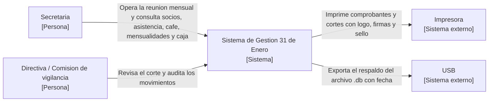

# 02 · C4 nivel 1 — Contexto del sistema

**Proyecto:** Sistema de Gestión Automatizada y Auditoría — Asociación “31 de Enero Narciza de Jesús”
**Nivel C4:** 1 (contexto) · **Atributo trabajado:** todo el alcance · **Escenarios:** E1–E6 (contexto)
**Versión:** v0.1.0

Representa el sistema como **una sola caja**, con las personas y los sistemas externos que interactúan con él. **No se muestran tecnologías** (los contenedores viven en el nivel 2).

## Elementos y responsabilidades

| Elemento | Tipo | Responsabilidad |
|----------|------|-----------------|
| Secretaria (S1) | Persona | Opera la reunión: socios, asistencia, café, mensualidades, caja, consulta y cierre |
| Directiva / Comisión de vigilancia (S3, S4) | Persona | Recibe el corte y los reportes; audita los movimientos |
| Sistema de Gestión 31 de Enero | Sistema | Digitaliza la operación mensual y audita el dinero de la asociación |
| Impresora | Sistema externo | Imprime comprobantes y cortes con logo, firmas y sello |
| USB | Sistema externo | Recibe el respaldo del archivo de datos |

## Relaciones (verbo + propósito)

- Secretaria → Sistema: **opere la reunión mensual y consulte** socios, asistencia, café, mensualidades y caja.
- Directiva / Comisión de vigilancia → Sistema: **revise el corte y audite** los movimientos.
- Sistema → Impresora: **imprima** comprobantes (`CMP-fecha`) y cortes con logo, firmas y sello.
- Sistema → USB: **exporte** el respaldo del archivo `.db` con fecha.

## Diagrama como código (Mermaid)

**Verificación de renderizado:** abrir este archivo en GitHub (`docs/02-vistas-c4/c4-nivel1-contexto.md`) o en un editor Mermaid; el bloque debe mostrar el diagrama sin errores. Nivel separado: no aparecen contenedores ni tecnologías.

**Cobertura de escenarios:** E2 (un usuario no autenticado no aparece como actor porque el sistema solo admite a la secretaria autenticada), E6 (relación Sistema → USB: respaldo).
