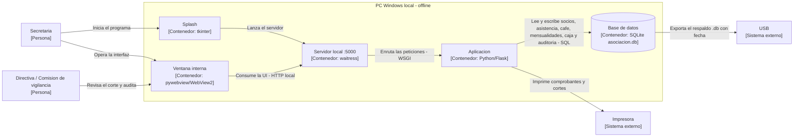

# 02 · C4 nivel 2 — Contenedores

**Proyecto:** Sistema de Gestión Automatizada y Auditoría — Asociación “31 de Enero Narciza de Jesús”
**Nivel C4:** 2 (contenedores) · **Atributos:** Fiabilidad (E1, E6), Seguridad (E2), Usabilidad/Portabilidad (E4)
**Versión:** v0.1.0 · Refleja la decisión de estilo **ADR-003** (monolito local monousuario)

Abre la caja del sistema para mostrar las aplicaciones y el almacén de datos con su **tecnología**, y las relaciones **etiquetadas**. Un solo nivel (no se mezclan niveles C4).

## Contenedores y responsabilidad

| Contenedor | Tecnología | Responsabilidad | Atiende (driver · escenario) |
|------------|------------|-----------------|------------------------------|
| Splash | tkinter fullscreen | Muestra el logo al arrancar y lanza el servidor | D4 · E4 |
| Servidor local | waitress (:5000) | Sirve la aplicación en la PC, sin consola ni internet | D4 · E4 |
| Aplicación | Python + Flask (`app.py` + plantillas Jinja2) | Reglas de negocio: socios, reunión, café, mensualidades, caja, auditoría, integridad, login | D1, D2, D3, D6 · E1–E6 |
| Base de datos | SQLite (`asociacion.db`, 1 archivo) | Persistencia con restricciones `UNIQUE` y claves foráneas | D1, D2 · E1, E2, E6 |
| Ventana interna | pywebview (WebView2/Edge) fullscreen | Muestra la interfaz sin exponer URLs | D4 · E4 |
| Impresora | — (sistema externo) | Recibe comprobantes y cortes | D6 · E1, E5 |
| USB | — (sistema externo) | Recibe el respaldo `.db` | D1 · E6 |

## Relaciones (verbo + tecnología)

- Secretaria → Splash: **inicia el programa** (doble clic al ejecutable).
- Secretaria → Ventana interna: **opera la interfaz** (pantalla completa, UI local).
- Splash → Servidor local: **lanza el servidor** (arranque en hilo).
- Ventana interna ↔ Servidor local: **consume la UI** (HTTP local).
- Servidor local → Aplicación: **enruta las peticiones** (WSGI).
- Aplicación → Base de datos: **lee y escribe** socios, asistencia, café, mensualidades, caja y auditoría (SQL).
- Aplicación → Impresora: **imprime** comprobantes y cortes (HTML/CSS de impresión).
- Base de datos → USB: **exporta el respaldo** (descarga `.db` con fecha).

## Diagrama como código (Mermaid)

**Nombres consistentes** con `01-contexto-y-drivers.md` y con `03-adr/` (Splash, Servidor local, Aplicación, Base de datos, Ventana interna).

**Cobertura de escenarios:** E1 y E6 (relación Aplicación → Base de datos y Base de datos → USB), E2 (login y auditoría en la Aplicación), E4 (Splash → Servidor → Ventana, sin internet), E5 (Aplicación → Impresora para el comprobante).

> Si la decisión de estilo (ADR-003) cambiara a un esquema con red, este nivel incluiría nuevos contenedores. La versión vigente (monolito local) **no requiere broker ni servicios separados**.

## Antes / después de ADR-003

- **Antes (candidatas A2, A3):** aparecerían un servidor de base de datos en red (A2) o servicios independientes, un broker y credenciales entre servicios (A3).
- **Después (ADR-003, A1 elegida):** un único proceso Flask + un archivo SQLite sobre la misma PC; sin red, sin broker. Este diagrama es el **estado final** de la decisión.
