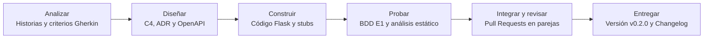

# Mapa de Toolchain: Priorización de Tareas de Alto Volumen con Herramientas CASE

**Proyecto:** Sistema de Gestión Automatizada y Auditoría para la Asociación "31 de Enero Narciza de Jesús"  
**Módulo:** Módulo 8 · Automatización de proceso de software  
**Programa:** Maestría en Ingeniería de Software - UPEC  
**Documento:** `docs/05-mapa-toolchain.md`  
**Versión:** v0.2.0  

---

## 1. El Caso: De Analizar el Producto a Analizar el Proceso

En el **Dossier de Arquitectura (v0.1.0)** se definieron los requerimientos, los escenarios de calidad (E1 a E6), la arquitectura C4 Niveles 1 y 2, y las decisiones de diseño mediante los Registros de Decisión Arquitectónica (**ADR-001** para la persistencia local SQLite, **ADR-002** para la centralización de reglas financieras y **ADR-003** para el estilo monolítico web local 100% offline).

En esta etapa del proyecto, el objeto de análisis se traslada desde el **producto** hacia el **proceso de desarrollo y verificación**, con el objetivo de identificar, puntuar y priorizar las tareas de alto volumen que deben ser asistidas por herramientas CASE (Computer-Aided Software Engineering) e Inteligencia Artificial.

---

## Paso 1 · Describir el Proceso del Proyecto

El proceso de desarrollo del Sistema de Gestión "31 de Enero" comprende seis etapas contiguas. Cada etapa produce artefactos específicos y cuenta con roles asignados dentro del equipo.

### Tabla de Etapas, Artefactos y Roles Responsables

| Etapa | Artefactos Producidos | Rol Responsable |
| :--- | :--- | :--- |
| **Analizar** | Historias de usuario (HU) con criterios de aceptación en Gherkin (`docs/06-historias-y-criterios.md`), matriz de trazabilidad entre HU, escenarios (E1-E6) y arquitectura. | Arquitecto de Software / Analista de Requisitos |
| **Diseñar** | Vistas de arquitectura C4 Niveles 1 y 2 en Mermaid (`docs/02-vistas-c4/`), Registros de Decisión Arquitectónica (`docs/03-adr/`) y contrato de API OpenAPI (`openapi/openapi.yaml`). | Arquitecto de Software y Responsable CASE |
| **Construir** | Código fuente del monolito local en Python/Flask (`src/app.py`), base de datos SQLite (`asociacion.db`), capa de reglas financieras centralizadas y *stubs* de endpoints. | Equipo de Desarrollo |
| **Probar** | Pruebas automáticas BDD de consistencia financiera (E1), validación de concurrencia/integridad en SQLite, pruebas de aceptación y análisis estático con linter. | Responsable de Calidad (QA) y Pipeline |
| **Integrar y revisar** | Revisiones cruzadas de código mediante rúbrica en parejas y solicitudes de cambio (*Pull Requests*) documentadas en el repositorio GitHub. | Responsable de Repositorio y Releases |
| **Entregar** | Versión etiquetada (`v0.2.0`), registro de cambios (*Changelog* SemVer) y documentación consolidada publicada. | Responsable de Repositorio y Releases |

### Flujo del Proceso en Mermaid

---

## Paso 2 · Listar Diez Tareas del Proceso

Se catalogan diez tareas concretas, repetitivas, frecuentes y verificables a lo largo del ciclo de vida del software:

| ID | Etapa | Tarea Concreta | Frecuencia Estimada |
| :--- | :--- | :--- | :--- |
| **T1** | Analizar | Redactar los criterios de aceptación en sintaxis Gherkin (`.feature`) a partir de los escenarios de calidad (E1 consistencia financiera y E2 seguridad). | Por cada historia de usuario. |
| **T2** | Analizar | Mantener la trazabilidad bidireccional: Historia de Usuario $\rightarrow$ Escenario $\rightarrow$ Criterio Gherkin $\rightarrow$ Endpoint OpenAPI $\rightarrow$ ADR. | En cada historia, escenario, endpoint o ADR nuevo o modificado. |
| **T3** | Diseñar | Actualizar los diagramas C4 como código (Mermaid) cuando un ADR altera la estructura de contenedores o relaciones del monolito. | Cuando un ADR cambia componentes o relaciones. |
| **T4** | Diseñar | Validar el contrato de API (`openapi/openapi.yaml`) mediante el linter Spectral dentro de un contenedor Docker. | En cada modificación del contrato OpenAPI. |
| **T5** | Diseñar | Generar la documentación interactiva y el servidor *mock* (Prism) a partir del contrato OpenAPI. | En cada actualización del contrato OpenAPI. |
| **T6** | Construir | Crear el código base (*stubs*) de los endpoints (socios, asistencia, cobro de reunión y caja chica) con OpenAPI Generator CLI. | Por cada endpoint o al regenerar tras un cambio del contrato. |
| **T7** | Probar | Escribir y ejecutar pruebas BDD/aceptación de la regla financiera (multa $5.00, café $1.50/$3.00, cuota $25.00 y cierre en $\le 2\text{ s}$) contra SQLite. | En cada cambio en el núcleo de la aplicación (`app.py`). |
| **T8** | Probar | Ejecutar el linter (Flake8/Pylint) y el análisis estático del código fuente del monolito Flask. | En cada *commit* realizado al repositorio. |
| **T9** | Integrar y revisar | Revisar el código y las solicitudes de cambio (*Pull Requests*) aplicando la rúbrica de revisión cruzada en parejas. | Por cada propuesta de cambio a integrar en la rama principal. |
| **T10** | Entregar | Generar el registro de cambios (*Changelog*) y el número de versión formal con convención SemVer (`v0.2.0`). | En cada liberación de versión o hito. |

---

## Paso 3 · Puntuar Frecuencia × Esfuerzo × Riesgo ($F \times E \times R$)

Cada tarea se evalúa en una escala cuantitativa de 1 a 5 para determinar su puntaje de prioridad ($Puntaje = F \times E \times R$, máximo 125). Umbrales de prioridad: **Alta** ($\ge 60$), **Media** ($20\text{--}59$), **Baja** ($\le 19$).

### Matriz de Puntuación de Tareas

| ID | Tarea Concreta | Frecuencia ($F$) | Esfuerzo ($E$) | Riesgo ($R$) | Puntaje ($F \times E \times R$) | Prioridad |
| :--- | :--- | :---: | :---: | :---: | :---: | :---: |
| **T1** | Criterios de aceptación en Gherkin | 3 | 3 | 2 | **18** | **Baja** |
| **T2** | Trazabilidad Historia $\rightarrow$ ADR | 3 | 3 | 3 | **27** | **Media** |
| **T3** | Actualizar diagramas C4 (Mermaid) | 2 | 3 | 2 | **12** | **Baja** |
| **T4** | Validar el contrato OpenAPI (Spectral) | 4 | 4 | 4 | **64** | **Alta** |
| **T5** | Documentación y *mock* (Prism) | 4 | 3 | 3 | **36** | **Media** |
| **T6** | Crear código base (*stubs*) de endpoints | 4 | 4 | 3 | **48** | **Media** |
| **T7** | Pruebas de consistencia financiera (E1) y BDD | 4 | 5 | 5 | **100** | **Alta** |
| **T8** | Linter y análisis estático de código | 5 | 2 | 3 | **30** | **Media** |
| **T9** | Revisión de *Pull Requests* en parejas | 4 | 3 | 3 | **36** | **Media** |
| **T10** | *Changelog* y etiquetado SemVer | 2 | 2 | 2 | **8** | **Baja** |

### Justificación de Puntuaciones basada en Hechos Observables

* **T1 ($3 \times 3 \times 2 = 18$)**: Frecuencia 3 (una vez por historia de usuario); Esfuerzo 3 (traducir el cálculo de cuotas/multas a sintaxis Dado/Cuando/Entonces conserva la precisión); Riesgo 2 (un error en la redacción se detecta en la revisión de la historia).
* **T2 ($3 \times 3 \times 3 = 27$)**: Frecuencia 3 (se actualiza con cada modificación en historias o ADR); Esfuerzo 3 (cruzar 5 artefactos manualmente); Riesgo 3 (una trazabilidad rota no detiene el servicio, pero oculta qué ADR revisar ante un fallo en el cobro).
* **T3 ($2 \times 3 \times 2 = 12$)**: Frecuencia 2 (solo cambia si se modifica la estructura en un ADR); Esfuerzo 3 (editar código Mermaid y verificar renderizado); Riesgo 2 (un diagrama desactualizado no frena la ejecución del código).
* **T4 ($4 \times 4 \times 4 = 64$)**: Frecuencia 4 (múltiples iteraciones al diseñar los endpoints); Esfuerzo 4 (revisar a mano métodos, esquemas y códigos HTTP en YAML extenso); Riesgo 4 (un contrato defectuoso propaga errores a los stubs y al cobro del escenario E1).
* **T5 ($4 \times 3 \times 3 = 36$)**: Frecuencia 4 (en cada cambio de `openapi.yaml`); Esfuerzo 3 (múltiples pasos manuales para levantar el servidor *mock*); Riesgo 3 (un *mock* desactualizado genera inconsistencias entre la UI y el backend).
* **T6 ($4 \times 4 \times 3 = 48$)**: Frecuencia 4 (existen 4+ endpoints: socios, asistencia, cobro y caja chica); Esfuerzo 4 (crear a mano controladores, esquemas y validaciones en Flask); Riesgo 3 (un *stub* incorrecto rompe la ejecución de los endpoints).
* **T7 ($4 \times 5 \times 5 = 100$)**: Frecuencia 4 (en cada cambio del núcleo en `app.py`); Esfuerzo 5 (validar manualmente el cálculo financiero de los 69 socios y el cierre de caja en SQLite exige múltiples casos); Riesgo 5 (afecta directamente el escenario E1: cualquier descuadre de un centavo viola los saldos exactos y el cierre bloqueante).
* **T8 ($5 \times 2 \times 3 = 30$)**: Frecuencia 5 (en cada *commit*); Esfuerzo 2 (un solo comando con Flake8/Pylint); Riesgo 3 (detecta defectos de estilo antes de la revisión, pero no valida reglas de negocio).
* **T9 ($4 \times 3 \times 3 = 36$)**: Frecuencia 4 (múltiples *Pull Requests* por semana); Esfuerzo 3 (leer cambios, comentar y verificar rúbrica); Riesgo 3 (una revisión omitida permite el ingreso de fallos al código).
* **T10 ($2 \times 2 \times 2 = 8$)**: Frecuencia 2 (solo al liberar un hito); Esfuerzo 2 (un comando `git tag` y revisión breve); Riesgo 2 (un *changelog* incorrecto se corrige fácilmente sin afectar la operación).

---

## Paso 4 · Elegir una Herramienta por Fase

Para cada fase del proceso se identifica la tarea de mayor puntaje, asignando una herramienta candidata clasificada según la categoría CASE (Upper CASE, Lower CASE e I-CASE), el riesgo de uso y la forma de verificación.

### Selección de Herramientas por Fase

| Fase | Tarea de Mayor Puntaje | Puntaje | Herramienta Candidata | Categoría | Riesgo de Uso | Dónde y Cómo se Verifica |
| :--- | :--- | :---: | :--- | :--- | :---: | :--- |
| **Analizar** | T2 Trazabilidad HU $\rightarrow$ ADR | 27 | GitHub Issues y Projects | Upper CASE | Medio | Tablero GitHub: verificación de vinculación directa entre HU, criterios Gherkin, endpoints y ADR. |
| **Diseñar** | T4 Contrato OpenAPI | 64 | Swagger Editor + Spectral (Docker) | Upper CASE | Medio | Terminal WSL/Docker: ejecución de `spectral lint` sobre `openapi.yaml` garantizando 0 errores. |
| **Construir** | T6 Código base de endpoints | 48 | OpenAPI Generator CLI | Lower CASE | Medio | Entorno Flask: verificación de que el esqueleto arranca y expone las rutas coincidiendo con el contrato. |
| **Probar** | T7 Pruebas de consistencia (E1) | 100 | Cucumber.js / Pytest-BDD + Asistente IA | Lower CASE | Alto | Ejecución de pruebas BDD: 100% de saldos exactos en multas/café y 0 inconsistencias en cierre de caja (E1). |
| **Integrar y revisar** | T9 Revisión de *Pull Requests* | 36 | GitHub (Pull Requests) con revisión humana | Lower CASE | Medio | Repositorio GitHub: rúbrica de revisión cruzada completada antes de aprobar el *merge*. |
| **Entregar** | T10 *Changelog* y versión | 8 | Git / GitHub Releases (`git tag v0.2.0`) | Lower CASE | Bajo | Repositorio: verificación del etiquetado SemVer `v0.2.0` y correspondencia del *changelog* con los *commits*. |

### Clasificación de Tareas Priorizadas y Habilitantes

* **Tareas Priorizadas (mayor puntaje)**: **T7 (100)**, **T4 (64)** y **T6 (48)**. Sobre estas tres tareas se concentran la instalación, pruebas iniciales y registro de evidencia de herramientas CASE.
* **Tareas Habilitantes**: **T1** (provee criterios Gherkin para alimentar T7), **T2** (trazabilidad del sistema), **T5** (*mock* del contrato con Prism), **T8** (linter de código) y **T9** (revisión en parejas).

---

## Paso 5 · Conectar el Mapa con las Sesiones 5 y 6 y el Alcance

Se articula el mapa de herramientas con las actividades prácticas y los entregables de las Sesiones 5 y 6:

### Matriz de Articulación con Sesiones Prácticas

| Sesión | Práctica | Tareas del Mapa | Herramientas Utilizadas | Artefactos Reutilizados del Dossier de Arquitectura |
| :--- | :--- | :--- | :--- | :--- |
| **S5** | Del requisito al contrato | T1, T2, T4, T5 | Gherkin (`.feature`), GitHub Projects, Swagger Editor, Spectral (Docker) y Prism. | Escenarios E1 y E2 como criterios de aceptación; C4 Nivel 2 como límite de la API del monolito; ADR-001 y ADR-002 para la trazabilidad. |
| **S6** | Generar y verificar | T6, T7, T8, T9 | OpenAPI Generator, Cucumber/Pytest-BDD, Asistente de IA (Copilot), Flake8/Pylint y Pull Requests. | Medida del escenario E1 como prueba de aceptación (cierre en $\le 2\text{ s}$ y 0 inconsistencias); restricción de unicidad de fecha/periodo (ADR-001); contrato `openapi.yaml` y criterios redactados en S5. |

### Alcance Definido según la Rúbrica
El esqueleto ejecutable cubre los casos de uso principales de la reunión mensual en el monolito Flask: gestión de socios, cobro de cuotas, multas, servicio de café, consulta e impresión de comprobante y cierre de caja chica. Cualquier funcionalidad extendida (notificaciones asíncronas o integración con *brokers* de eventos) queda explícitamente marcada como extensión posterior, garantizando la coherencia con el alcance delimitado en el Dossier de Arquitectura y en la Rúbrica de la Semana 2.
