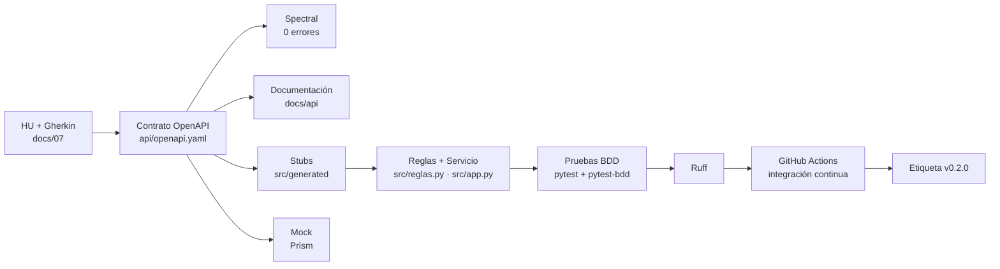

# 09 · Informe Final de la Cadena CASE

**Proyecto:** Sistema de Gestión Automatizada y Auditoría — Asociación “31 de Enero Narciza de Jesús”
**Módulo 8 · Automatización de proceso de software · Actividad autónoma Semana 2 — Informe y artefactos de la cadena CASE**
**Versión:** v0.2.0 · **Fecha:** 25/10/2026
**Equipo:** Bolívar Imbaquingo · Valery (rama `valery/toolchain`) · apoyo de un asistente de IA bajo verificación humana.

---

## 1. Propósito

Este informe consolida la **cadena CASE** del proyecto: el mapa de toolchain, las historias con criterios de aceptación ejecutables, el contrato OpenAPI, la documentación y el *mock*, el esqueleto ejecutable con pruebas y la matriz de evaluación y selección de herramientas. El objetivo es demostrar que la cadena **funciona de extremo a extremo** y que cada artefacto se **verificó con ejecución real**, no solo sobre el papel.

El objeto del trabajo cambia respecto a la Semana 1: ya no se analiza el *producto* (arquitectura), sino el **proceso de desarrollo y verificación** para decidir qué tareas de alto volumen conviene apoyar con herramientas CASE (ISO/IEC/IEEE 12207:2017) y cómo seleccionarlas (ISO/IEC 14102:2008).

---

## 2. La cadena, paso a paso

| # | Etapa | Artefacto | Herramienta | Verificación |
| :---: | :--- | :--- | :--- | :--- |
| 1 | Analizar | `docs/07-historias-y-criterios.md` (7 HU + Gherkin) y matriz de trazabilidad | GitHub Issues/Projects + asistente de IA | Revisión humana y trazabilidad HU ↔ escenario ↔ endpoint |
| 2 | Diseñar | `api/openapi.yaml` (12 operaciones) y `.spectral.yaml` | Swagger Editor + **Spectral** | `spectral lint` → 0 errores (`docs/evidencias/02-spectral-lint.txt`) |
| 3 | Diseñar | `docs/api/index.html` (documentación) | OpenAPI Generator (`html2`) | Archivo generado desde el contrato |
| 4 | Construir | `src/generated/` (*stubs* `python-flask`) | OpenAPI Generator (`python-flask`) | Rutas idénticas al contrato |
| 5 | Construir | `src/reglas.py` + `src/app.py` (implementación) | Python + Flask + SQLite | Pruebas de integración HTTP |
| 6 | Probar | `tests/features/*.feature` + `tests/test_bdd.py` | **pytest + pytest-bdd** | `pytest` → 34 pruebas en verde |
| 7 | Probar | Análisis estático de `src/` y `tests/` | **Ruff** | `ruff check` → *All checks passed!* |
| 8 | Mock | Servidor simulado desde el contrato | **Prism** | `GET /socios` 200, `POST …/cafe` 201 |
| 9 | Integrar y revisar | `docs/08-matriz-evaluacion-seleccion.md` + revisión cruzada | GitHub Actions + *Pull Requests* | Lint + pruebas antes del *merge* |
| 10 | Entregar | Etiqueta `v0.2.0` y este informe | Git / GitHub Releases | `git tag v0.2.0` |

### Vista de la cadena



---

## 3. Artefactos producidos

| Artefacto | Ruta | Descripción |
| :--- | :--- | :--- |
| Mapa de toolchain | `docs/06-mapa-toolchain.md` | Proceso por fases, 10 tareas priorizadas (F×E×R) y herramientas por fase. |
| Historias y criterios | `docs/07-historias-y-criterios.md` | 7 HU con criterios de aceptación en Gherkin y matriz de trazabilidad. |
| Contrato OpenAPI | `api/openapi.yaml` | 12 operaciones; sin exposición de datos personales (R1/LOPDP). |
| Reglas de lint del contrato | `.spectral.yaml` | `extends: ["spectral:oas"]`. |
| Documentación generada | `docs/api/index.html` | HTML producido con OpenAPI Generator (`html2`). |
| *Stubs* del servicio | `src/generated/openapi-flask/` | Código base del contrato (`python-flask`). |
| Lógica de negocio | `src/reglas.py` | Tarifas y reglas financieras en un único punto + SQLite. |
| Servicio HTTP | `src/app.py` | Espejo ejecutable del contrato montado en `/api/v1`. |
| Pruebas | `tests/` | Unitarias por criterio de aceptación, integración HTTP y BDD. |
| Matriz de selección | `docs/08-matriz-evaluacion-seleccion.md` | Evaluación de herramientas con pesos (ISO/IEC 14102). |
| Registro de IA | `docs/04-registro-ia.md` | Uso de IA con verificación, aceptación y rechazo. |
| Evidencias | `docs/evidencias/` | Transcripciones de cada ejecución. |

---

## 4. Evidencia de verificación (ejecución real)

| Evidencia | Comando | Resultado |
| :--- | :--- | :--- |
| `docs/evidencias/01-entorno-versiones.txt` | `node -v`, `java -version`, `spectral --version`, … | Node 24.22.1 · Java 17.0.20.1 · Spectral 6.17.0 · Prism 5.16.0 · OpenAPI Generator 7.26.0 · Python 3.12.10 |
| `docs/evidencias/02-spectral-lint.txt` | `spectral lint api/openapi.yaml` | **0 errores, 0 advertencias** |
| `docs/evidencias/03-openapi-generator-docs.txt` | `openapi-generator-cli generate -g html2` | Documentación generada |
| `docs/evidencias/04-openapi-generator-stubs.txt` | `openapi-generator-cli generate -g python-flask` | *Stubs* generados |
| `docs/evidencias/05-prism-mock.txt` | `prism mock api/openapi.yaml` | 200/201 con los ejemplos del contrato |
| `docs/evidencias/06-ruff.txt` | `ruff check src tests` | *All checks passed!* |
| `docs/evidencias/07-pytest.txt` | `pytest` | **34 passed** |

### Reproducir la cadena

```bash
# 1. Validar el contrato
spectral lint api/openapi.yaml

# 2. Generar documentación y stubs
openapi-generator-cli generate -i api/openapi.yaml -g html2 -o docs/api
openapi-generator-cli generate -i api/openapi.yaml -g python-flask -o src/generated/openapi-flask

# 3. Levantar el mock
prism mock api/openapi.yaml --port 4010

# 4. Lint y pruebas del esqueleto ejecutable
pip install -r requirements-dev.txt
ruff check src tests
pytest
```

---

## 5. Trazabilidad historia → endpoint → prueba

| HU | Regla de negocio | Endpoint | Prueba asociada |
| :--- | :--- | :--- | :--- |
| HU-01 | Máximo 69 socios, unicidad, baja lógica | `POST /socios`, `GET /socios` | `tests/test_socios.py` |
| HU-02 | Multa de $5,00 por inasistencia | `POST /reuniones/{id}/asistencia` | `tests/test_asistencia.py`, `features/asistencia.feature` |
| HU-03 | Café $1,50 / $3,00 según grupo de turno | `POST /reuniones/{id}/cafe` | `tests/test_cafe.py`, `features/cafe.feature` |
| HU-04 | Cuota de $25,00 y abonos parciales | `POST /reuniones/{id}/cuotas` | `tests/test_cuota.py` |
| HU-05 | Cierre bloqueante y corte consistente | `POST /reuniones/{id}/cierre`, `GET /reuniones/{id}/caja` | `tests/test_cierre.py` |
| HU-06 | Estado de cuenta y comprobante | `GET /socios/{socioId}/estado-cuenta`, `…/comprobante` | `tests/test_api.py` |
| HU-07 | Respaldo en ≤ 5 s y 9 chequeos de integridad | `POST /sistema/respaldo`, `GET /sistema/integridad` | `tests/test_sistema.py` |

---

## 6. Calidad y seguridad

* **Consistencia financiera (E1):** las pruebas verifican saldos exactos (multa $5,00, café $1,50/$3,00, cuota $25,00) y **0 inconsistencias** en el corte de caja.
* **Inmutabilidad (ADR-002):** tras el cierre, toda modificación devuelve HTTP 403; un segundo cierre devuelve HTTP 409.
* **Minimización de datos (R1/LOPDP):** el contrato no expone la cédula; `tests/test_api.py` comprueba que el padrón no la devuelve.
* **Contrato (T4):** Spectral no reporta errores ni advertencias, y Prism valida que el contrato es consumible por un cliente.

---

## 7. Uso de inteligencia artificial

El asistente de IA participó como **borrador**, no como autoridad: redactó escenarios Gherkin, pruebas y documentación. Cada salida se verificó con Spectral, Ruff y pytest, y se registró en `docs/04-registro-ia.md`. El hallazgo más relevante fue un borrador que **devolvía la cédula** en el padrón: se **rechazó** y se sustituyó por `socioId`, reforzando la minimización de datos. No se ingresaron datos personales reales en ninguna herramienta.

---

## 8. Conclusiones y trabajo posterior

1. La cadena CASE queda **operativa y reproducible** desde un único contrato (`api/openapi.yaml`): validación, documentación, *mock*, *stubs*, implementación y pruebas se derivan de él.
2. La priorización por **frecuencia × esfuerzo × riesgo** concentró el esfuerzo en T7, T4 y T6, y las tres se probaron realmente con evidencia en el repositorio.
3. La selección de herramientas (ISO/IEC 14102) se sustenta en la evidencia de esta iteración, no en la publicidad de los fabricantes.
4. **Trabajo posterior:** activar la integración continua en cada *Pull Request* (GitHub Actions), ampliar la cobertura de pruebas de concurrencia en SQLite y completar las lecturas de apoyo (resúmenes ISO/IEC/IEEE 29148 y Pro Git, capítulos 1 y 2).
